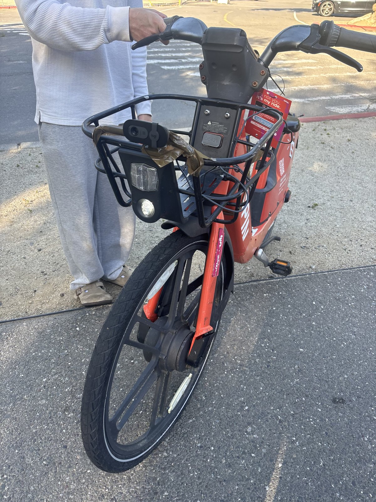
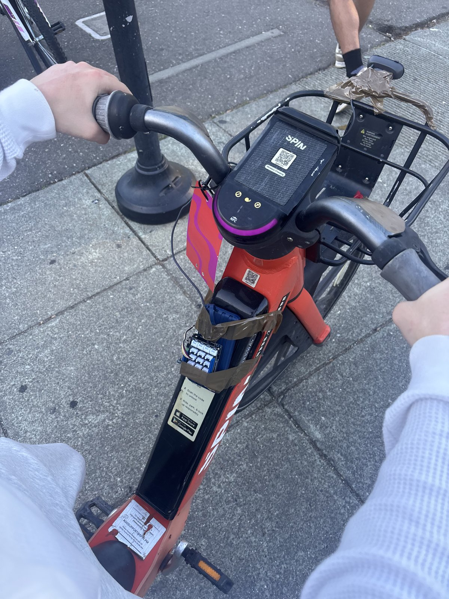
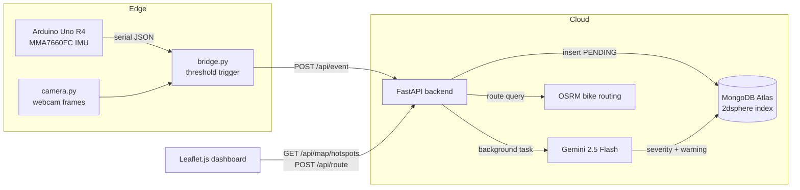

# Baze: Real-Time Bike Hazard Detection

Baze clips onto a bike and detects road hazards while you ride. It watches for them with a vibration sensor and a camera, then puts them on a live campus map with routes that go around them.

**Built in 48 hours at HackDavis 2026.**


<p align="center">
  
  &nbsp;
  
</p>
<p align="center"><em>Left: the front-facing camera on the basket. Right: the Arduino Uno R4 and accelerometer on the frame.</em></p>

---

## The problem

Bikes don't have suspension, crumple zones, or any safety systems built in. When a cyclist hits a pothole, crack, or debris they didn't see, they can get hurt. On a campus like UC Davis, thousands of students ride every day, and damaged pavement can go months without anyone reporting it.

Baze turns every ride into a road-quality survey. It detects hazards automatically, shows them on a shared map, and routes other riders around them.

## How it works

1. **Sense.** An Arduino reads a 3-axis accelerometer and streams its vibration readings (RMS and peak g-force) to a laptop over serial.
2. **Trigger.** An edge script watches for readings above a threshold (`rms > 0.12g` or `peak > 0.20g`). When one arrives, it takes a camera snapshot and records the next 5 seconds of sensor data.
3. **Ingest.** The event goes to a FastAPI backend, which saves it right away as a `PENDING` hazard and responds without waiting for the analysis.
4. **Classify.** A background task sends the vibration time series and the camera frame to Gemini 2.5 Flash. Gemini rates the event **RED**, **ORANGE**, or **GREEN** and writes a plain-English warning. GREEN events are thrown out.
5. **Map and route.** The dashboard polls the API every 3 seconds and draws the hazards. The route planner calculates a bike route, finds hazards near it, and computes a detour around them.

## Architecture



## Engineering highlights

- **Asynchronous ingestion.** `/api/event` saves the event and returns right away. The slow multimodal AI call runs as a FastAPI background task, so the edge device never waits on the model.
- **Multimodal classification instead of fixed thresholds.** Threshold rules alone set off false alarms constantly: a single bump, a loose cable, or someone touching the sensor. Gemini looks at the full 5-second vibration curve together with the camera frame, so it can tell a speed bump (ORANGE) from sustained rough pavement with debris in view (RED).
- **Geospatial storage.** Hazards are stored as GeoJSON points with a MongoDB `2dsphere` index. The map endpoint returns a GeoJSON `FeatureCollection` that Leaflet renders directly.
- **Hazard-aware routing.** The planner gets a direct route from OSRM and flags hazards within 50 m of it. It groups hazards within 200 m of each other into clusters, then tries detour waypoints offset 65 m to the left and right of each cluster. It keeps the shortest detour and falls back to the direct route if the detour would be more than 60% longer.
- **Rate limiting at the edge.** After each event, the bridge waits 15 seconds before it can trigger again, so one rough stretch doesn't flood the backend.

## Tech stack

| Layer | Technology |
| --- | --- |
| Hardware | Arduino Uno R4 WiFi, Grove MMA7660FC 3-axis accelerometer, USB webcam |
| Firmware | C++ (Arduino) |
| Edge | Python, pyserial, OpenCV |
| Backend | FastAPI, Uvicorn, Pydantic |
| Database | MongoDB Atlas (geospatial `2dsphere` index) |
| AI | Google Gemini 2.5 Flash (multimodal) |
| Routing | OSRM (OpenStreetMap bike profile), Nominatim geocoding |
| Frontend | JavaScript, Leaflet.js |

## API

| Method | Endpoint | Description |
| --- | --- | --- |
| `POST` | `/api/event` | Takes in a sensor session (time series + optional image) and queues AI analysis |
| `GET` | `/api/map/hotspots` | Returns all hazards as a GeoJSON `FeatureCollection` |
| `POST` | `/api/route` | Returns the direct route and a hazard-avoiding route between two points |
| `DELETE` | `/api/map/reset` | Clears all hazards |
| `GET` | `/health` | Health check with the hazard count |

## Repository structure

```
Baze/
├── arduino/CycleSentinel/CycleSentinel.ino   # Firmware: reads the IMU, streams JSON over serial
├── bridge.py                                 # Edge: trigger detection, session recording, upload
├── camera.py                                 # Edge: captures webcam frames for analysis
├── backend/
│   ├── main.py                               # FastAPI: ingestion, Gemini analysis, geo queries, routing
│   └── requirements.txt
├── dashboard/index.html                      # Live hazard map and route planner
└── docs/images/                              # Project photos
```

## Running locally

**Prerequisites:** Python 3.11+, the Arduino IDE with the "Arduino UNO R4 Boards" package, a MongoDB Atlas cluster (the free tier works), and a Gemini API key.

```bash
# 1. Backend
cd backend
python3 -m venv venv && source venv/bin/activate
pip install -r requirements.txt
echo "MONGO_URI=mongodb+srv://..."   >> .env
echo "GEMINI_API_KEY=..."            >> .env
uvicorn main:app --host 0.0.0.0 --port 8000

# 2. Firmware: open arduino/CycleSentinel/CycleSentinel.ino in the Arduino IDE and upload it
#    (plug the accelerometer into the Grove Shield's I2C port, powered at 3.3V)

# 3. Edge scripts, in separate terminals from the repo root
python3 camera.py
python3 bridge.py

# 4. Dashboard
open dashboard/index.html
```

## Limitations and next steps

- **Location is simulated.** There was no GPS module in the hackathon build, so the backend places hazards along preset UC Davis campus waypoints. Adding a GPS module is the top priority.
- **The edge device is tethered.** The bridge runs on a laptop over USB. Next, the trigger logic should move onto the microcontroller so events upload over Wi-Fi.
- **The dashboard polls.** It checks the API every 3 seconds. WebSockets or server-sent events would push updates as they happen.
- **Facilities reporting.** RED hazards could automatically become work orders for campus facilities, closing the loop from detection to repair.

## Team

Built by **Yogya Mehrotra**, **Sid Shastri**, **Adam Carter**, and **Karthik Konda** at HackDavis 2026.
