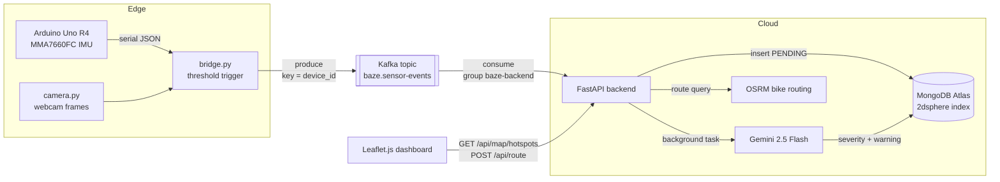

# Baze: Real-Time Bike Hazard Detection

Baze clips onto a bike and detects road hazards while you ride. It watches for them with a vibration sensor and a camera, then puts them on a live campus map with routes that go around them.

**Built in 48 hours at HackDavis 2026.**


<p align="center">
  
  &nbsp;
  
</p>
<p align="center"><em>Left: the front-facing camera on the basket. Right: the Arduino Uno R4 and accelerometer on the frame.</em></p>

---

## The problem

Bikes don't have suspension, crumple zones, or any safety systems built in. When a cyclist hits a pothole, crack, or debris they didn't see, they can get hurt. On a campus like UC Davis, thousands of students ride every day, and damaged pavement can go months without anyone reporting it.

Baze turns every ride into a road-quality survey. It detects hazards automatically, shows them on a shared map, and routes other riders around them.

## How it works

1. **Sense.** An Arduino reads a 3-axis accelerometer and streams its vibration readings (RMS and peak g-force) to a laptop over serial.
2. **Trigger.** An edge script watches for readings above a threshold (`rms > 0.12g` or `peak > 0.20g`). When one arrives, it takes a camera snapshot and records the next 5 seconds of sensor data.
3. **Stream.** The edge script publishes the event to the Kafka topic `baze.sensor-events`, keyed by the bike's device ID.
4. **Ingest.** A Kafka consumer inside the FastAPI backend reads the event, saves it right away as a `PENDING` hazard, and commits its offset.
5. **Classify.** A background task sends the vibration time series and the camera frame to Gemini 2.5 Flash. Gemini rates the event **RED**, **ORANGE**, or **GREEN** and writes a plain-English warning. GREEN events are thrown out.
6. **Map and route.** The dashboard polls the API every 3 seconds and draws the hazards. The route planner calculates a bike route, finds hazards near it, and computes a detour around them.

## Architecture



## Engineering highlights

- **Event-driven ingestion with Kafka.** The edge doesn't call the backend directly. It publishes each event to Kafka and moves on, and the backend consumes at its own pace. If the backend is down or slow, events wait in the topic (kept for 7 days) instead of being lost, and the backend catches up when it comes back. More bikes means more producers on the same topic, with no change to the backend.
- **At-least-once delivery without duplicates.** The consumer commits an offset only after the event is saved in MongoDB, so a crash means Kafka redelivers instead of dropping it. Every event carries an `event_id` from the edge, and the backend saves it with an upsert on that ID (backed by a unique index), so a redelivered event is a no-op. A malformed event is logged and skipped so it can't block its partition; a temporary failure such as MongoDB being unreachable is retried.
- **Per-bike ordering.** Messages are keyed by `device_id`, so all events from one bike land on the same partition and are read in order. The topic has 3 partitions, so up to 3 backend instances in the same consumer group can split the load.
- **Asynchronous AI analysis.** Saving the event is fast; the multimodal Gemini call is slow. The consumer saves the `PENDING` hazard, hands the Gemini call to a worker pool, and goes straight to the next message.
- **Multimodal classification instead of fixed thresholds.** Threshold rules alone set off false alarms constantly: a single bump, a loose cable, or someone touching the sensor. Gemini looks at the full 5-second vibration curve together with the camera frame, so it can tell a speed bump (ORANGE) from sustained rough pavement with debris in view (RED).
- **Geospatial storage.** Hazards are stored as GeoJSON points with a MongoDB `2dsphere` index. The map endpoint returns a GeoJSON `FeatureCollection` that Leaflet renders directly.
- **Hazard-aware routing.** The planner gets a direct route from OSRM and flags hazards within 50 m of it. It groups hazards within 200 m of each other into clusters, then tries detour waypoints offset 65 m to the left and right of each cluster. It keeps the shortest detour and falls back to the direct route if the detour would be more than 60% longer.
- **Rate limiting at the edge.** After each event, the bridge waits 15 seconds before it can trigger again, so one rough stretch doesn't flood the backend.

## Tech stack

| Layer | Technology |
| --- | --- |
| Hardware | Arduino Uno R4 WiFi, Grove MMA7660FC 3-axis accelerometer, USB webcam |
| Firmware | C++ (Arduino) |
| Edge | Python, pyserial, OpenCV, confluent-kafka (producer) |
| Streaming | Apache Kafka (KRaft mode, Docker Compose) |
| Backend | FastAPI, Uvicorn, Pydantic, confluent-kafka (consumer) |
| Database | MongoDB Atlas (geospatial `2dsphere` index) |
| AI | Google Gemini 2.5 Flash (multimodal) |
| Routing | OSRM (OpenStreetMap bike profile), Nominatim geocoding |
| Frontend | JavaScript, Leaflet.js |

## API

| Method | Endpoint | Description |
| --- | --- | --- |
| `POST` | `/api/event` | Takes in a sensor session directly over HTTP (used when the edge runs with `BAZE_TRANSPORT=http`) and queues AI analysis |
| `GET` | `/api/map/hotspots` | Returns all hazards as a GeoJSON `FeatureCollection` |
| `POST` | `/api/route` | Returns the direct route and a hazard-avoiding route between two points |
| `DELETE` | `/api/map/reset` | Clears all hazards |
| `GET` | `/health` | Health check with the hazard count and whether the Kafka consumer is on |

## Kafka pipeline

| Piece | Where | What it does |
| --- | --- | --- |
| Broker | `docker-compose.yml` | One Kafka 3.8 broker in KRaft mode (no ZooKeeper) on `localhost:9092` |
| Topic | `docker-compose.yml` (`kafka-init`) | Creates `baze.sensor-events`: 3 partitions, 7-day retention, 5 MB max message (events carry a camera frame). Auto-creation is off. |
| Producer | `bridge.py` | Sends each 5-second session as JSON, keyed by `device_id`, with `acks=all` and idempotence on |
| Consumer | `backend/kafka_consumer.py` | Runs in a background thread of the FastAPI app as group `baze-backend`, with manual offset commits |
| Simulator | `scripts/simulate_ride.py` | Sends fake sessions through the same producer, for testing without the bike |

Message format (one per event):

```json
{
  "event_id": "5ef0b0e2-…",
  "device_id": "bike-01",
  "samples": [{"t": 0.0, "x": 0.01, "y": -0.03, "z": 1.12, "rms": 0.35, "peak": 0.97}],
  "duration_s": 5.0,
  "max_peak": 0.97,
  "avg_rms": 0.35,
  "image_b64": "…or null"
}
```

Configuration (environment variables):

| Variable | Used by | Default |
| --- | --- | --- |
| `BAZE_TRANSPORT` | edge | `kafka` (set to `http` to POST to the backend instead) |
| `BAZE_DEVICE_ID` | edge | `bike-01` |
| `KAFKA_BOOTSTRAP_SERVERS` | edge, backend | edge: `localhost:9092`. Backend: unset, which turns the consumer off. |
| `KAFKA_TOPIC` | edge, backend | `baze.sensor-events` |
| `KAFKA_GROUP_ID` | backend | `baze-backend` |

## Repository structure

```
Baze/
├── arduino/CycleSentinel/CycleSentinel.ino   # Firmware: reads the IMU, streams JSON over serial
├── bridge.py                                 # Edge: trigger detection, session recording, Kafka producer
├── camera.py                                 # Edge: captures webcam frames for analysis
├── docker-compose.yml                        # Local Kafka broker + topic setup
├── backend/
│   ├── main.py                               # FastAPI: ingestion, Gemini analysis, geo queries, routing
│   ├── kafka_consumer.py                     # Kafka consumer that feeds events into main.py
│   └── requirements.txt
├── scripts/simulate_ride.py                  # Sends fake events, for testing without hardware
├── dashboard/index.html                      # Live hazard map and route planner
└── docs/images/                              # Project photos
```

## Running locally

**Prerequisites:** Python 3.11+, Docker, the Arduino IDE with the "Arduino UNO R4 Boards" package, a MongoDB Atlas cluster (the free tier works), and a Gemini API key.

```bash
# 1. Kafka (broker + topic)
docker compose up -d
docker compose logs kafka-init      # should print "Created topic baze.sensor-events"

# 2. Backend
cd backend
python3 -m venv venv && source venv/bin/activate
pip install -r requirements.txt
echo "MONGO_URI=mongodb+srv://..."              >> .env
echo "GEMINI_API_KEY=..."                       >> .env
echo "KAFKA_BOOTSTRAP_SERVERS=localhost:9092"   >> .env
uvicorn main:app --host 0.0.0.0 --port 8000

# 3. Firmware: open arduino/CycleSentinel/CycleSentinel.ino in the Arduino IDE and upload it
#    (plug the accelerometer into the Grove Shield's I2C port, powered at 3.3V)

# 4. Edge scripts, in separate terminals from the repo root
python3 camera.py
python3 bridge.py

# 5. Dashboard
open dashboard/index.html
```

**No hardware?** Skip steps 3 and 4 and run `python3 scripts/simulate_ride.py -n 5`. Events show up in the backend log and on the map.

Useful Kafka commands while it runs:

```bash
# Watch raw events on the topic
docker exec baze-kafka /opt/kafka/bin/kafka-console-consumer.sh \
  --bootstrap-server localhost:9092 --topic baze.sensor-events --from-beginning --property print.key=true

# See the backend's committed offsets and lag per partition
docker exec baze-kafka /opt/kafka/bin/kafka-consumer-groups.sh \
  --bootstrap-server localhost:9092 --describe --group baze-backend
```

## Limitations and next steps

- **Location is simulated.** There was no GPS module in the hackathon build, so the backend places hazards along preset UC Davis campus waypoints. Adding a GPS module is the top priority.
- **The edge device is tethered.** The bridge runs on a laptop over USB. Next, the trigger logic should move onto the microcontroller so events upload over Wi-Fi.
- **Kafka is a single local broker.** It has no replication, so the broker itself is a single point of failure. A deployed version would use a managed cluster (for example Amazon MSK or Confluent Cloud) with a replication factor of 3, plus TLS and authentication.
- **Gemini analysis isn't tracked by Kafka.** The offset is committed once the `PENDING` hazard is saved, and the Gemini call runs after that in memory. If the backend crashes in between, the hazard stays `PENDING`. A fix is to sweep for old `PENDING` hazards on startup, or to put analysis on its own topic.
- **Images ride inside the Kafka message.** That's fine for a few bikes, but at scale the frame should go to object storage (for example S3) with only its URL in the event.
- **The dashboard polls.** It checks the API every 3 seconds. WebSockets or server-sent events would push updates as they happen.
- **Facilities reporting.** RED hazards could automatically become work orders for campus facilities, closing the loop from detection to repair.

## Changelog

- **HackDavis 2026:** the edge POSTed events straight to the FastAPI backend.
- **After the hackathon:** moved edge-to-backend ingestion onto Kafka (producer, topic, consumer, Docker Compose) and added the ride simulator. Direct HTTP is still available with `BAZE_TRANSPORT=http`.

## Team

Built by **Yogya Mehrotra**, **Sid Shastri**, **Adam Carter**, and **Karthik Konda** at HackDavis 2026.
